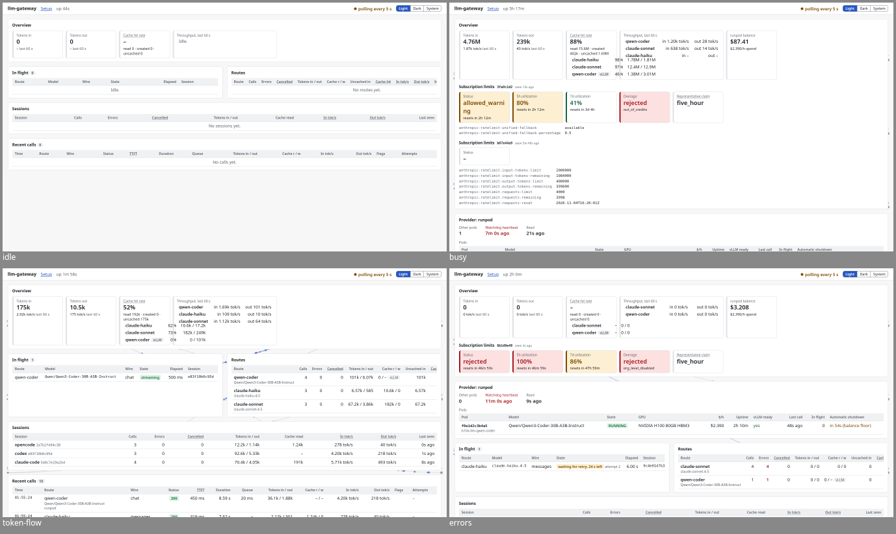
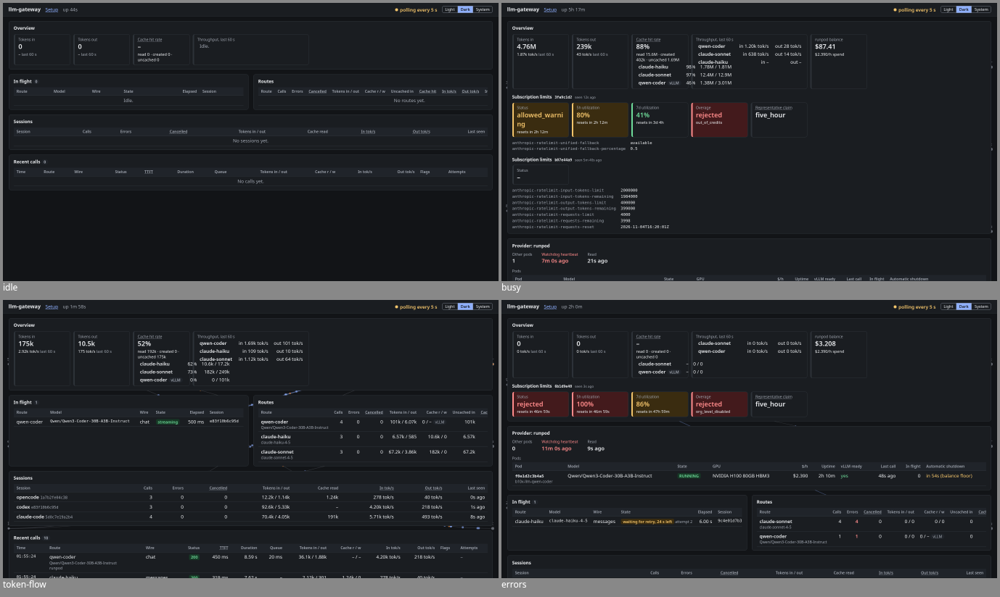
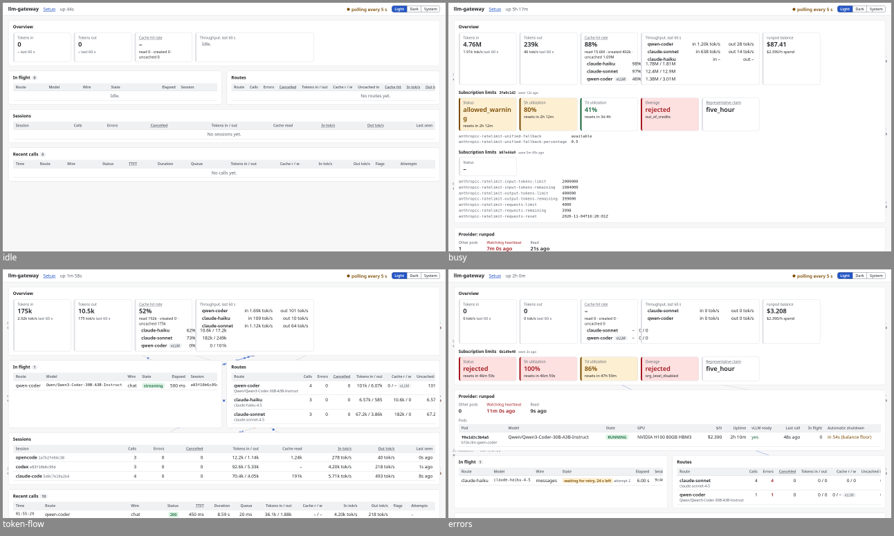
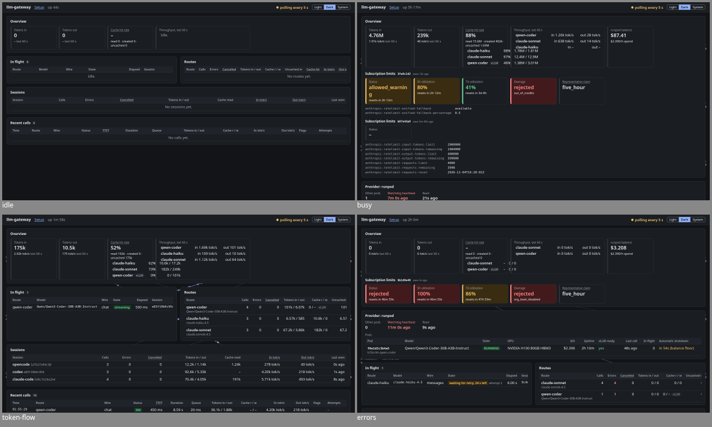

# Round R-02

Date 2026-11-26. Page commit `c4d7c91d`, built page sha256 `82ceb6386f06…`. Theme toggle: present.
Scenarios: `idle` (anchor), `busy` (anchor), `token-flow`, `errors` (anchor). Gating viewports 1366x768, 1280x720; measured-only 1536x754, 960x1080, 390x844.
Hermetic: every snapshot comes from `ux/scenarios/`; the page is the built `dashboard.html` on a fake origin; every other request is aborted.
Each state arrives as one complete `dashboard/events` response; when it ends the page falls back to polling until the next connection, so the connection status reads "polling every 5 s" in every shot.

## Hard gates (gating viewports)

| gate | theme | replays passing | headline |
|---|---|---|---|
| gate 1 layout | light | 2 of 8 | overflow 0 px max, 1 elements past their box max, 0 scrollers without keyboard access max |
| gate 1 truncation | light | 8 of 8 | 0 truncated without full value max |
| gate 2 always visible | light | 8 of 8 | header visible ratio 1 min; toggle present |
| gate 5 axe | light | 0 of 8 | 12 serious/critical nodes over 8 replays (scrollable-region-focusable) |
| gate 5 keyboard | light | 8 of 8 | 0 unreachable, 0 focus-invisible max |
| gate 5 reduced motion | light | 8 of 8 | 0 violations max |
| gate 1 layout | dark | 2 of 8 | overflow 0 px max, 1 elements past their box max, 0 scrollers without keyboard access max |
| gate 1 truncation | dark | 8 of 8 | 0 truncated without full value max |
| gate 2 always visible | dark | 8 of 8 | header visible ratio 1 min; toggle present |
| gate 5 axe | dark | 0 of 8 | 12 serious/critical nodes over 8 replays (scrollable-region-focusable) |
| gate 5 keyboard | dark | 8 of 8 | 0 unreachable, 0 focus-invisible max |
| gate 5 reduced motion | dark | 8 of 8 | 0 violations max |

## Metrics per scenario, worst over the gating viewports and themes (lower is better)

| scenario | axe.serious_critical | overflow.x_px | overflow.elements | overflow.scrollers_unreachable | header.hidden_ratio | keyboard.unreachable | keyboard.focus_invisible | key_font.deficit_px | layout_shift.per_state_max | reduced_motion.violations | truncation.without_full_value |
|---|---|---|---|---|---|---|---|---|---|---|---|
| idle | 1 | 0 | 0 | 0 | 0 | 0 | 0 | 1 | 0 | 0 | 0 |
| busy | 2 | 0 | 1 | 0 | 0 | 0 | 0 | 3.600 | 0 | 0 | 0 |
| token-flow | 1 | 0 | 1 | 0 | 0 | 0 | 0 | 3.600 | 0.074 | 0 | 0 |
| errors | 2 | 0 | 1 | 0 | 0 | 0 | 0 | 3.600 | 0.059 | 0 | 0 |

`key_font.deficit_px` is 14 px less the smallest key-data font; `header.hidden_ratio` is 1 less the smallest visible share of a header element.

## Every replay

| scenario | viewport | theme | axe | overflow px | past box | header visible | unreachable | focus invisible | key font px | layout shift max | reduced motion | truncated |
|---|---|---|---|---|---|---|---|---|---|---|---|---|
| busy | 1280x720 | dark | 2 | 0 | 1 | 1 | 0 | 0 | 10.4 | 0 | 0 | 0 |
| busy | 1280x720 | light | 2 | 0 | 1 | 1 | 0 | 0 | 10.4 | 0 | 0 | 0 |
| busy | 1366x768 | dark | 2 | 0 | 1 | 1 | 0 | 0 | 10.4 | 0 | 0 | 0 |
| busy | 1366x768 | light | 2 | 0 | 1 | 1 | 0 | 0 | 10.4 | 0 | 0 | 0 |
| busy | 1536x754 (measured) | dark | 2 | 0 | 1 | 1 | 0 | 0 | 10.4 | 0 | 0 | 0 |
| busy | 1536x754 (measured) | light | 2 | 0 | 1 | 1 | 0 | 0 | 10.4 | 0 | 0 | 0 |
| busy | 390x844 (measured) | dark | 4 | 0 | 5 | 1 | 0 | 0 | 10.4 | 0 | 0 | 0 |
| busy | 390x844 (measured) | light | 4 | 0 | 5 | 1 | 0 | 0 | 10.4 | 0 | 0 | 0 |
| busy | 960x1080 (measured) | dark | 3 | 0 | 1 | 1 | 0 | 0 | 10.4 | 0 | 0 | 0 |
| busy | 960x1080 (measured) | light | 3 | 0 | 1 | 1 | 0 | 0 | 10.4 | 0 | 0 | 0 |
| errors | 1280x720 | dark | 2 | 0 | 1 | 1 | 0 | 0 | 10.4 | 0.059 | 0 | 0 |
| errors | 1280x720 | light | 2 | 0 | 1 | 1 | 0 | 0 | 10.4 | 0.059 | 0 | 0 |
| errors | 1366x768 | dark | 2 | 0 | 1 | 1 | 0 | 0 | 10.4 | 0.057 | 0 | 0 |
| errors | 1366x768 | light | 2 | 0 | 1 | 1 | 0 | 0 | 10.4 | 0.057 | 0 | 0 |
| errors | 1536x754 (measured) | dark | 1 | 0 | 1 | 1 | 0 | 0 | 10.4 | 0.050 | 0 | 0 |
| errors | 1536x754 (measured) | light | 1 | 0 | 1 | 1 | 0 | 0 | 10.4 | 0.050 | 0 | 0 |
| errors | 390x844 (measured) | dark | 4 | 0 | 3 | 1 | 0 | 0 | 10.4 | 0.027 | 0 | 0 |
| errors | 390x844 (measured) | light | 4 | 0 | 3 | 1 | 0 | 0 | 10.4 | 0.027 | 0 | 0 |
| errors | 960x1080 (measured) | dark | 2 | 0 | 1 | 1 | 0 | 0 | 10.4 | 0.095 | 0 | 0 |
| errors | 960x1080 (measured) | light | 2 | 0 | 1 | 1 | 0 | 0 | 10.4 | 0.095 | 0 | 0 |
| idle | 1280x720 | dark | 1 | 0 | 0 | 1 | 0 | 0 | 13 | 0 | 0 | 0 |
| idle | 1280x720 | light | 1 | 0 | 0 | 1 | 0 | 0 | 13 | 0 | 0 | 0 |
| idle | 1366x768 | dark | 1 | 0 | 0 | 1 | 0 | 0 | 13 | 0 | 0 | 0 |
| idle | 1366x768 | light | 1 | 0 | 0 | 1 | 0 | 0 | 13 | 0 | 0 | 0 |
| idle | 1536x754 (measured) | dark | 1 | 0 | 0 | 1 | 0 | 0 | 13 | 0 | 0 | 0 |
| idle | 1536x754 (measured) | light | 1 | 0 | 0 | 1 | 0 | 0 | 13 | 0 | 0 | 0 |
| idle | 390x844 (measured) | dark | 3 | 0 | 2 | 1 | 0 | 0 | 13 | 0 | 0 | 0 |
| idle | 390x844 (measured) | light | 3 | 0 | 2 | 1 | 0 | 0 | 13 | 0 | 0 | 0 |
| idle | 960x1080 (measured) | dark | 1 | 0 | 0 | 1 | 0 | 0 | 13 | 0 | 0 | 0 |
| idle | 960x1080 (measured) | light | 1 | 0 | 0 | 1 | 0 | 0 | 13 | 0 | 0 | 0 |
| token-flow | 1280x720 | dark | 1 | 0 | 1 | 1 | 0 | 0 | 10.4 | 0.074 | 0 | 0 |
| token-flow | 1280x720 | light | 1 | 0 | 1 | 1 | 0 | 0 | 10.4 | 0.074 | 0 | 0 |
| token-flow | 1366x768 | dark | 1 | 0 | 1 | 1 | 0 | 0 | 10.4 | 0.070 | 0 | 0 |
| token-flow | 1366x768 | light | 1 | 0 | 1 | 1 | 0 | 0 | 10.4 | 0.070 | 0 | 0 |
| token-flow | 1536x754 (measured) | dark | 1 | 0 | 1 | 1 | 0 | 0 | 10.4 | 0.072 | 0 | 0 |
| token-flow | 1536x754 (measured) | light | 1 | 0 | 1 | 1 | 0 | 0 | 10.4 | 0.072 | 0 | 0 |
| token-flow | 390x844 (measured) | dark | 4 | 0 | 3 | 1 | 0 | 0 | 10.4 | 0.098 | 0 | 0 |
| token-flow | 390x844 (measured) | light | 4 | 0 | 3 | 1 | 0 | 0 | 10.4 | 0.098 | 0 | 0 |
| token-flow | 960x1080 (measured) | dark | 3 | 0 | 1 | 1 | 0 | 0 | 10.4 | 0.064 | 0 | 0 |
| token-flow | 960x1080 (measured) | light | 3 | 0 | 1 | 1 | 0 | 0 | 10.4 | 0.064 | 0 | 0 |

## Worst moments

- `axe.serious_critical` = 4 at busy 390x844 dark: scrollable-region-focusable: section[aria-labelledby="h-provider"] > .scroll; section[aria-labelledby="h-inflight"] > .scroll; section[aria-labelledby="h-routes"] > .scroll
- `overflow.elements` = 5 at busy 390x844 dark: table.mini "claude-haiku 98%1.78M / 1.81Mclaude-sonn" past div.tile "Cache hit rate88% read 15.6M · created 4" / dd.mono "available" past dl.headers "anthropic-ratelimit-unified-fallbackavai" / dd.mono "0.5" past dl.headers "anthropic-ratelimit-unified-fallbackavai"
- `key_font.deficit_px` = 3.600 at busy 1280x720 dark: 10.4 px at span.badge "vLLM"
- `layout_shift.per_state_max` = 0.098 at token-flow 390x844 dark: per state: 0.098, 0.079, 0.067, 0.023, 0.034, 0.01, 0.017

## Ratchet against `ux/baseline.json`

- every value equals the baseline within its tolerance

## Contact sheets

The last state of each scenario, 0.75 s after it arrived, at half size.

