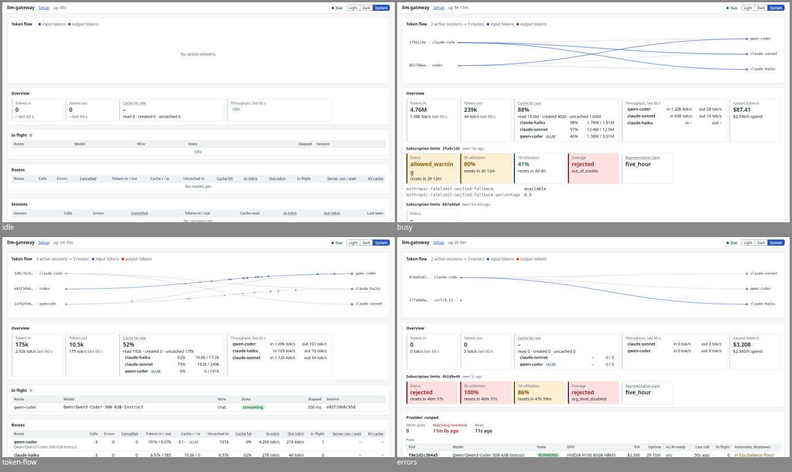
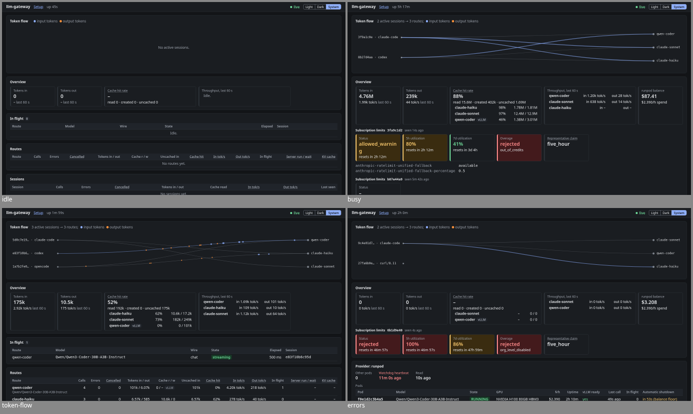
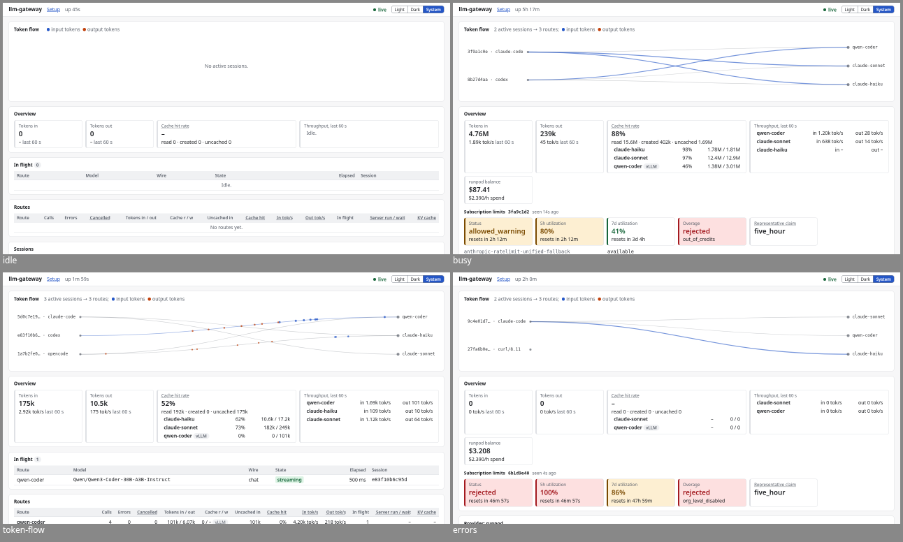
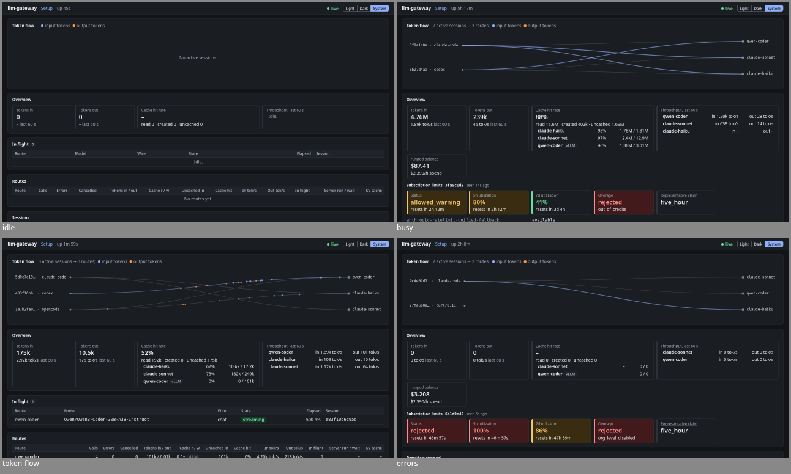

# Round R-03

Date 2026-11-26. Page commit `6bd91d70289c`, built page sha256 `f283cdb1c34f…`. Theme toggle: present.
Tools: Chromium 158.0.8127.18, axe-core 4.14.1 (@axe-core/playwright 4.14.1), Playwright 1.65.0, harness commit `6bd91d70289c`.
Scenarios: `idle` (anchor), `busy` (anchor), `token-flow`, `errors` (anchor). Gating viewports 1366x768, 1280x720; measured-only 1536x754, 960x1080, 390x844.

## Method

- Hermetic: every snapshot comes from `ux/scenarios/`; the page is the built `dashboard.html` on a fake origin; every other request is aborted (`blocked` in round.json).
- The first state answers the one `dashboard/snapshot` fetch; every state then arrives as one `snapshot` event on a stand-in event stream that opened once and stays open, as the gateway serves it, so the connection status reads "live" and the page never polls.
- Layout shift per state: the sum of layout-shift entries from the moment the state is pushed to two animation frames later. No state is pushed within 600 ms of a harness click or key press, since the browser leaves out shifts that soon after an input; the value does not depend on what ran before it (an axe scan, a wait).
- axe-core scans every state of every replay and the page after every action; a rule counts the distinct nodes over all scans.
- The token-flow canvas is measured at the last state, scrolled to the top: `flow.visible_ratio` is the share of a 32 x 16 grid over its box that lies in the viewport with nothing painted over it; `flow.drawn` is whether it holds pixels other than its background.

## Hard gates (gating viewports)

| gate | theme | replays passing | headline |
|---|---|---|---|
| gate 1 layout | light | 8 of 8 | overflow 0 px max, 0 elements past their box max, 0 scrollers Tab never reaches max (Chromium focuses a scrolling box itself; axe judges the markup) |
| gate 1 truncation | light | 8 of 8 | 0 truncated without full value max |
| gate 2 always visible | light | 8 of 8 | header visible ratio 1 min; toggle present |
| gate 5 axe | light | 8 of 8 | 0 serious/critical nodes over 8 replays (none) |
| gate 5 keyboard | light | 8 of 8 | 0 unreachable, 0 focus-invisible max |
| gate 5 reduced motion | light | 8 of 8 | 0 violations max |
| flow (token-flow) | light | 2 of 2 | visible ratio 1 min (bar 0.95), drawn 2 of 2 |
| replay hermetic and live | light | 8 of 8 | 0 requests aborted |
| gate 1 layout | dark | 8 of 8 | overflow 0 px max, 0 elements past their box max, 0 scrollers Tab never reaches max (Chromium focuses a scrolling box itself; axe judges the markup) |
| gate 1 truncation | dark | 8 of 8 | 0 truncated without full value max |
| gate 2 always visible | dark | 8 of 8 | header visible ratio 1 min; toggle present |
| gate 5 axe | dark | 8 of 8 | 0 serious/critical nodes over 8 replays (none) |
| gate 5 keyboard | dark | 8 of 8 | 0 unreachable, 0 focus-invisible max |
| gate 5 reduced motion | dark | 8 of 8 | 0 violations max |
| flow (token-flow) | dark | 2 of 2 | visible ratio 1 min (bar 0.95), drawn 2 of 2 |
| replay hermetic and live | dark | 8 of 8 | 0 requests aborted |

## Metrics per scenario, worst value (lower is better)

"gating" is the worst over the gating viewports and both themes, the basis of the ratchet; "all" is the worst over every viewport.

| metric | idle gating | idle all | busy gating | busy all | token-flow gating | token-flow all | errors gating | errors all |
|---|---|---|---|---|---|---|---|---|
| axe.serious_critical | 0 | 0 | 0 | 0 | 0 | 0 | 0 | 0 |
| overflow.x_px | 0 | 0 | 0 | 0 | 0 | 0 | 0 | 0 |
| overflow.elements | 0 | 0 | 0 | 0 | 0 | 0 | 0 | 0 |
| overflow.scrollers_unreachable | 0 | 0 | 0 | 0 | 0 | 0 | 0 | 0 |
| header.hidden_ratio | 0 | 0.200 | 0 | 0.200 | 0 | 0.200 | 0 | 0.200 |
| keyboard.unreachable | 0 | 0 | 0 | 0 | 0 | 0 | 0 | 0 |
| keyboard.focus_invisible | 0 | 0 | 0 | 0 | 0 | 0 | 0 | 0 |
| key_font.deficit_px | 0 | 0 | 1.750 | 1.750 | 1.750 | 1.750 | 1.750 | 1.750 |
| layout_shift.per_state_max | 0 | 0 | 0 | 0 | 0.059 | 0.071 | 0.007 | 0.023 |
| reduced_motion.violations | 0 | 0 | 0 | 0 | 0 | 0 | 0 | 0 |
| truncation.without_full_value | 0 | 0 | 0 | 0 | 0 | 0 | 0 | 0 |
| key font px, smallest (n/a: no key data) | 14 | 14 | 12.25 | 12.25 | 12.25 | 12.25 | 12.25 | 12.25 |
| flow.visible_ratio, smallest (higher is better) | 1 | 1 | 1 | 1 | 1 | 1 | 1 | 1 |
| flow.drawn, replays drawn | 0/4 | 0/10 | 4/4 | 10/10 | 4/4 | 10/10 | 4/4 | 10/10 |

`key_font.deficit_px` is 14 px less the smallest key-data font, 0 where a page shows no key data; `header.hidden_ratio` is 1 less the smallest visible share of a header element; `axe.rule.<id>` counts the distinct nodes of one rule over every scan.

## Every replay

| scenario | viewport | theme | axe | overflow px | past box | header visible | unreachable | focus invisible | key font px | layout shift max | reduced motion | truncated | flow visible | flow drawn | status |
|---|---|---|---|---|---|---|---|---|---|---|---|---|---|---|---|
| busy | 1280x720 | dark | 0 | 0 | 0 | 1 | 0 | 0 | 12.25 | 0 | 0 | 0 | 1 | yes | live |
| busy | 1280x720 | light | 0 | 0 | 0 | 1 | 0 | 0 | 12.25 | 0 | 0 | 0 | 1 | yes | live |
| busy | 1366x768 | dark | 0 | 0 | 0 | 1 | 0 | 0 | 12.25 | 0 | 0 | 0 | 1 | yes | live |
| busy | 1366x768 | light | 0 | 0 | 0 | 1 | 0 | 0 | 12.25 | 0 | 0 | 0 | 1 | yes | live |
| busy | 1536x754 (measured) | dark | 0 | 0 | 0 | 1 | 0 | 0 | 12.25 | 0 | 0 | 0 | 1 | yes | live |
| busy | 1536x754 (measured) | light | 0 | 0 | 0 | 1 | 0 | 0 | 12.25 | 0 | 0 | 0 | 1 | yes | live |
| busy | 390x844 (measured) | dark | 0 | 0 | 0 | 0.8 | 0 | 0 | 12.25 | 0 | 0 | 0 | 1 | yes | live |
| busy | 390x844 (measured) | light | 0 | 0 | 0 | 0.8 | 0 | 0 | 12.25 | 0 | 0 | 0 | 1 | yes | live |
| busy | 960x1080 (measured) | dark | 0 | 0 | 0 | 1 | 0 | 0 | 12.25 | 0 | 0 | 0 | 1 | yes | live |
| busy | 960x1080 (measured) | light | 0 | 0 | 0 | 1 | 0 | 0 | 12.25 | 0 | 0 | 0 | 1 | yes | live |
| errors | 1280x720 | dark | 0 | 0 | 0 | 1 | 0 | 0 | 12.25 | 0.005 | 0 | 0 | 1 | yes | live |
| errors | 1280x720 | light | 0 | 0 | 0 | 1 | 0 | 0 | 12.25 | 0.005 | 0 | 0 | 1 | yes | live |
| errors | 1366x768 | dark | 0 | 0 | 0 | 1 | 0 | 0 | 12.25 | 0.007 | 0 | 0 | 1 | yes | live |
| errors | 1366x768 | light | 0 | 0 | 0 | 1 | 0 | 0 | 12.25 | 0.007 | 0 | 0 | 1 | yes | live |
| errors | 1536x754 (measured) | dark | 0 | 0 | 0 | 1 | 0 | 0 | 12.25 | 0.006 | 0 | 0 | 1 | yes | live |
| errors | 1536x754 (measured) | light | 0 | 0 | 0 | 1 | 0 | 0 | 12.25 | 0.006 | 0 | 0 | 1 | yes | live |
| errors | 390x844 (measured) | dark | 0 | 0 | 0 | 0.8 | 0 | 0 | 12.25 | 0.011 | 0 | 0 | 1 | yes | live |
| errors | 390x844 (measured) | light | 0 | 0 | 0 | 0.8 | 0 | 0 | 12.25 | 0.011 | 0 | 0 | 1 | yes | live |
| errors | 960x1080 (measured) | dark | 0 | 0 | 0 | 1 | 0 | 0 | 12.25 | 0.023 | 0 | 0 | 1 | yes | live |
| errors | 960x1080 (measured) | light | 0 | 0 | 0 | 1 | 0 | 0 | 12.25 | 0.023 | 0 | 0 | 1 | yes | live |
| idle | 1280x720 | dark | 0 | 0 | 0 | 1 | 0 | 0 | 14 | 0 | 0 | 0 | 1 | no | live |
| idle | 1280x720 | light | 0 | 0 | 0 | 1 | 0 | 0 | 14 | 0 | 0 | 0 | 1 | no | live |
| idle | 1366x768 | dark | 0 | 0 | 0 | 1 | 0 | 0 | 14 | 0 | 0 | 0 | 1 | no | live |
| idle | 1366x768 | light | 0 | 0 | 0 | 1 | 0 | 0 | 14 | 0 | 0 | 0 | 1 | no | live |
| idle | 1536x754 (measured) | dark | 0 | 0 | 0 | 1 | 0 | 0 | 14 | 0 | 0 | 0 | 1 | no | live |
| idle | 1536x754 (measured) | light | 0 | 0 | 0 | 1 | 0 | 0 | 14 | 0 | 0 | 0 | 1 | no | live |
| idle | 390x844 (measured) | dark | 0 | 0 | 0 | 0.8 | 0 | 0 | 14 | 0 | 0 | 0 | 1 | no | live |
| idle | 390x844 (measured) | light | 0 | 0 | 0 | 0.8 | 0 | 0 | 14 | 0 | 0 | 0 | 1 | no | live |
| idle | 960x1080 (measured) | dark | 0 | 0 | 0 | 1 | 0 | 0 | 14 | 0 | 0 | 0 | 1 | no | live |
| idle | 960x1080 (measured) | light | 0 | 0 | 0 | 1 | 0 | 0 | 14 | 0 | 0 | 0 | 1 | no | live |
| token-flow | 1280x720 | dark | 0 | 0 | 0 | 1 | 0 | 0 | 12.25 | 0.043 | 0 | 0 | 1 | yes | live |
| token-flow | 1280x720 | light | 0 | 0 | 0 | 1 | 0 | 0 | 12.25 | 0.043 | 0 | 0 | 1 | yes | live |
| token-flow | 1366x768 | dark | 0 | 0 | 0 | 1 | 0 | 0 | 12.25 | 0.059 | 0 | 0 | 1 | yes | live |
| token-flow | 1366x768 | light | 0 | 0 | 0 | 1 | 0 | 0 | 12.25 | 0.059 | 0 | 0 | 1 | yes | live |
| token-flow | 1536x754 (measured) | dark | 0 | 0 | 0 | 1 | 0 | 0 | 12.25 | 0.046 | 0 | 0 | 1 | yes | live |
| token-flow | 1536x754 (measured) | light | 0 | 0 | 0 | 1 | 0 | 0 | 12.25 | 0.046 | 0 | 0 | 1 | yes | live |
| token-flow | 390x844 (measured) | dark | 0 | 0 | 0 | 0.8 | 0 | 0 | 12.25 | 0.017 | 0 | 0 | 1 | yes | live |
| token-flow | 390x844 (measured) | light | 0 | 0 | 0 | 0.8 | 0 | 0 | 12.25 | 0.017 | 0 | 0 | 1 | yes | live |
| token-flow | 960x1080 (measured) | dark | 0 | 0 | 0 | 1 | 0 | 0 | 12.25 | 0.071 | 0 | 0 | 1 | yes | live |
| token-flow | 960x1080 (measured) | light | 0 | 0 | 0 | 1 | 0 | 0 | 12.25 | 0.071 | 0 | 0 | 1 | yes | live |

## Worst moments at the gating viewports

- `key_font.deficit_px` = 1.750 at busy 1280x720 dark: 12.25 px at span.badge "vLLM"
- `layout_shift.per_state_max` = 0.059 at token-flow 1366x768 dark: per state: 0.059, 0.047, 0.03, 0.009, 0.015, 0.004, 0.007

## Worst moments at the measured-only viewports (no screenshot)

- `header.hidden_ratio` = 0.200 at busy 390x844 dark: –
- `key_font.deficit_px` = 1.750 at busy 1536x754 dark: 12.25 px at span.badge "vLLM"
- `layout_shift.per_state_max` = 0.071 at token-flow 960x1080 dark: per state: 0.067, 0.06, 0.071, 0.018, 0.029, 0.008, 0.014

## Ratchet against `ux/baseline.json` (gating values)

- every value equals the baseline within its tolerance

## Contact sheets

The last state of each scenario, 0.75 s after it arrived, at half size.

