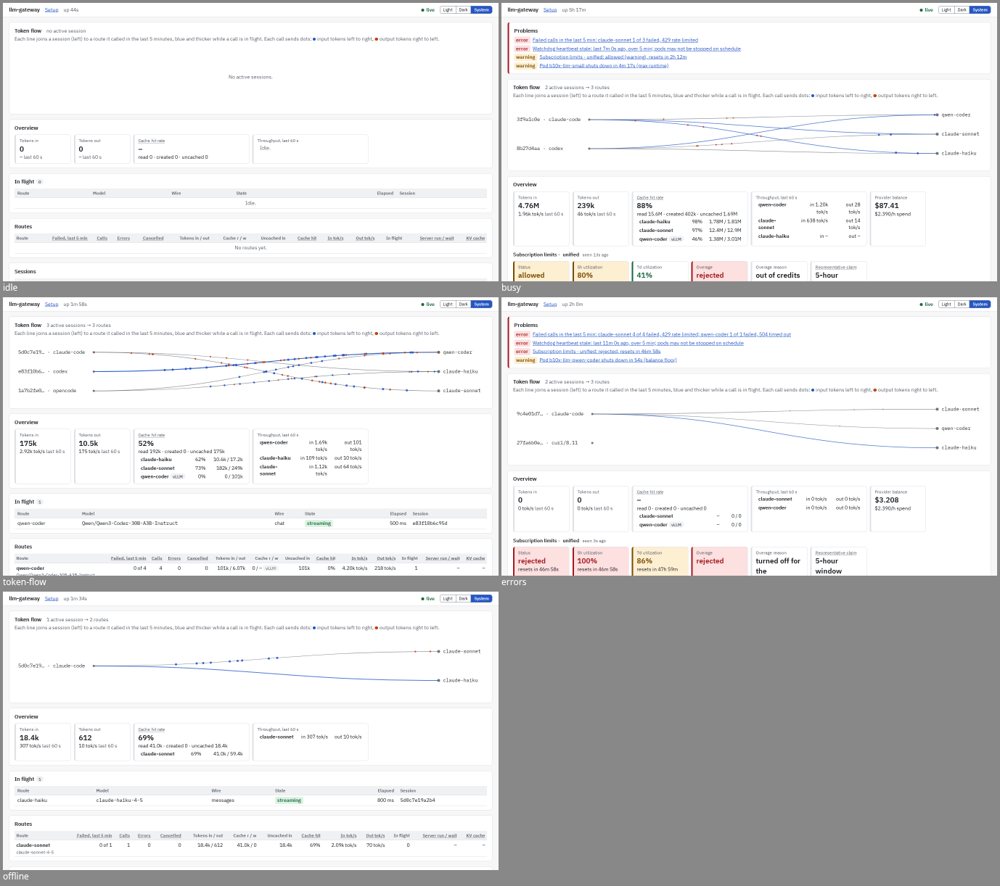
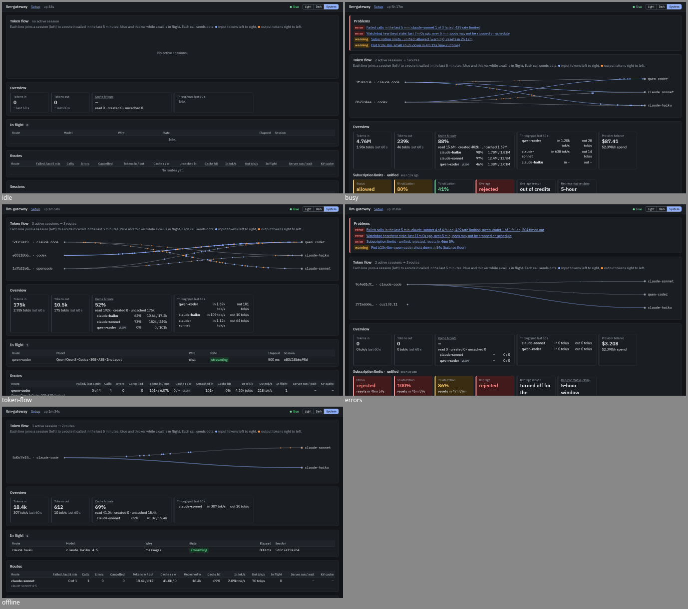
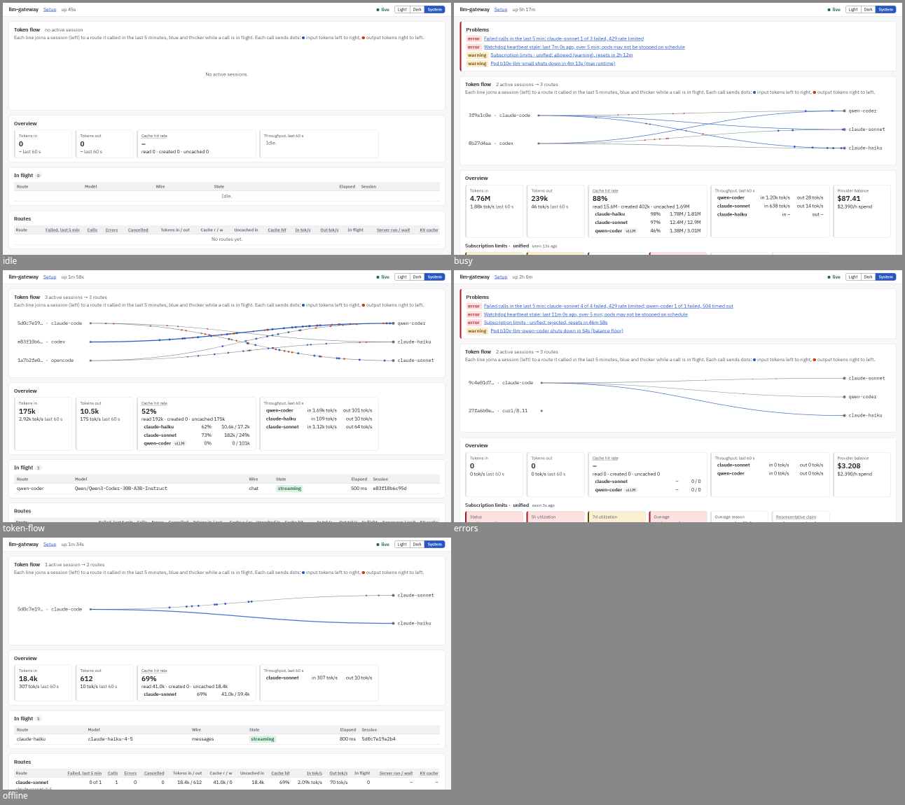
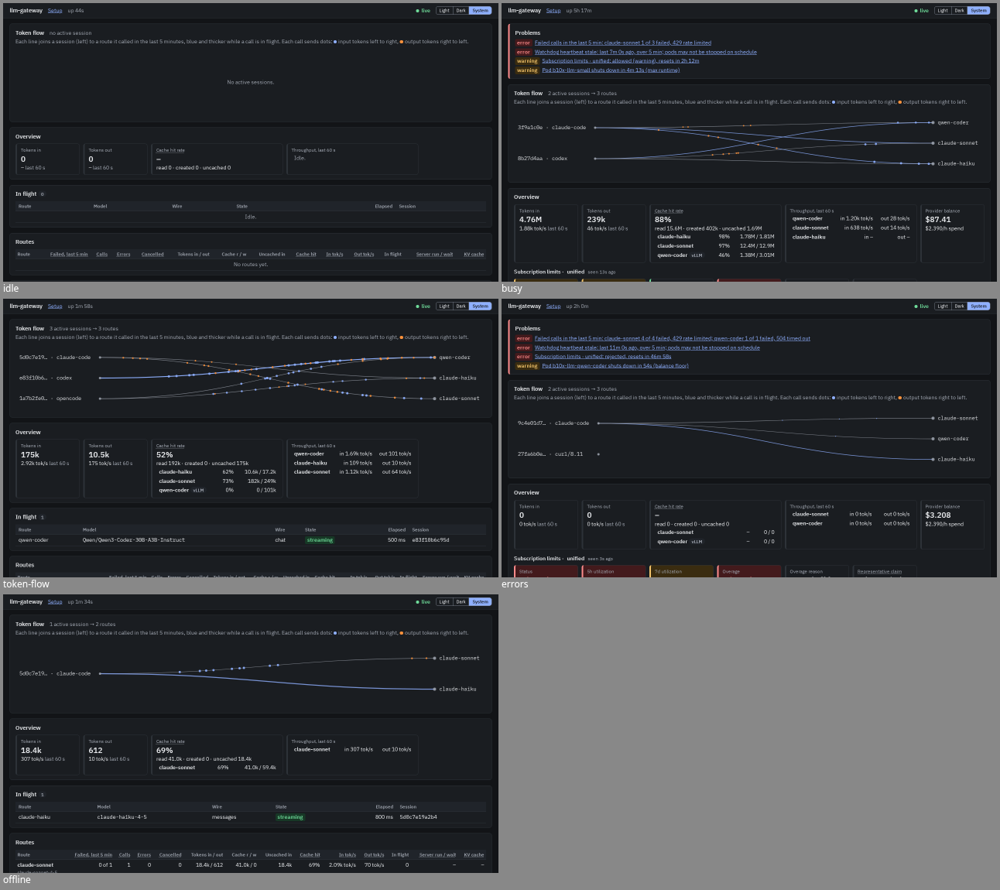
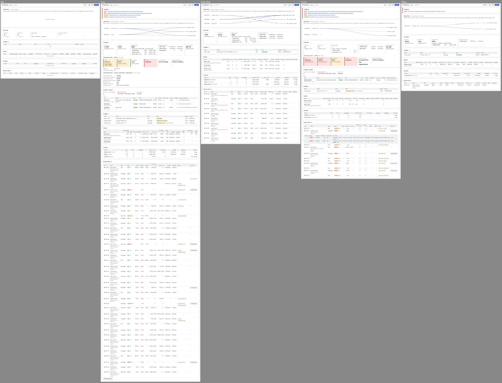
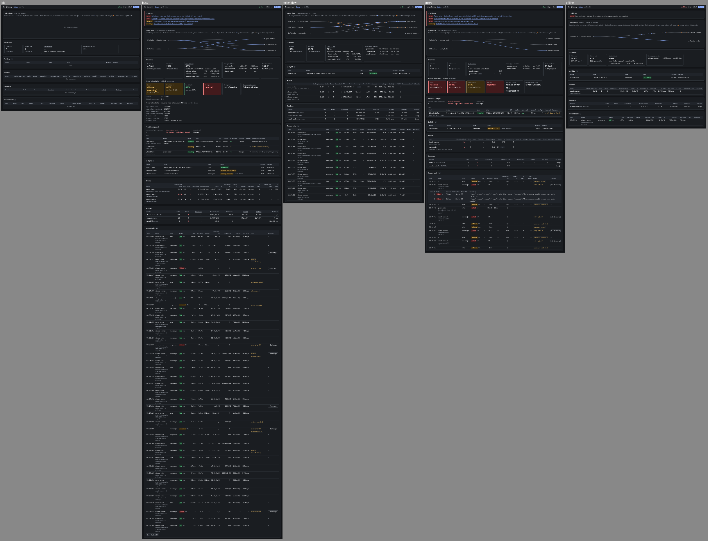

# Round R-07

Date 2026-11-26. Page commit `193c83bb`, built page sha256 `a07c861bbc3a…`. Theme toggle: present.
Tools: Chromium 158.0.8127.18, axe-core 4.14.1 (@axe-core/playwright 4.14.1), Playwright 1.65.0, harness commit `193c83bb`. Fonts: pinned: IBM Plex Sans and IBM Plex Mono 1.1.0, Latin-1.
Scenarios: `idle` (anchor), `busy` (anchor), `token-flow`, `errors` (anchor), `offline`. Gating viewports 1366x768, 1280x720; measured-only 1536x754, 960x1080, 390x844.

## Method

- Hermetic: every snapshot comes from `ux/scenarios/`; the page is the built `dashboard.html` on a fake origin; every other request is aborted (`blocked` in round.json).
- The first state answers the one `dashboard/snapshot` fetch; every state then arrives as one `snapshot` event on a stand-in event stream that opened once and stays open, as the gateway serves it, so the connection status reads "live" and the page never polls.
- A scenario that loses its connection (`offline`) ends with the stream erroring and every later snapshot fetch answering 503; the page's poll is held and run once by the harness, so the replay sees exactly one failed poll.
- Layout shift per state: the sum of layout-shift entries from the moment the state is pushed to two animation frames later. No state is pushed within 600 ms of a harness click or key press, since the browser leaves out shifts that soon after an input; the value does not depend on what ran before it (an axe scan, a wait).
- axe-core scans every state of every replay and the page after every action; a rule counts the distinct nodes over all scans.
- The visible-text probe (e2e/copy.ts) reads every text run at every state and after every action: words run together across elements, a raw identifier as a label, a control named by a glyph. The key-data probe floors every text outside the header: key data and headings at 14 px, the rest at 12 px.
- The screen-only user (e2e/screen-only.ts) plays the tasks of a scenario with a `truth` (busy, errors) in the light theme at each gating viewport, on a replay of its own after the last state, with reduced motion.
- Fonts: pinned: IBM Plex Sans and IBM Plex Mono 1.1.0, Latin-1. The pinned fonts are committed under `e2e/fonts/` and installed in every replay before the page's first script, so every host measures the same text widths (e2e/fonts.ts); "host" measures with the fonts the host has installed and is not the gate.
- The token-flow canvas is measured at the last state, scrolled to the top: `flow.visible_ratio` is the share of a 32 x 16 grid over its box that lies in the viewport with nothing painted over it; `flow.drawn` is whether it holds pixels other than its background.

## Hard gates (gating viewports)

| gate | theme | replays passing | headline |
|---|---|---|---|
| gate 1 layout | light | 10 of 10 | overflow 0 px max, 0 elements past their box max, 0 scrollers Tab never reaches max (Chromium focuses a scrolling box itself; axe judges the markup) |
| gate 1 truncation | light | 10 of 10 | 0 truncated without full value max |
| gate 2 always visible | light | 10 of 10 | header visible ratio 1 min; toggle present |
| gate 2 always visible, every viewport | light | 25 of 25 | hidden: none |
| gate 5 axe | light | 10 of 10 | 0 serious/critical nodes over 10 replays (none) |
| gate 5 keyboard | light | 10 of 10 | 0 unreachable, 0 focus-invisible max |
| gate 5 reduced motion | light | 10 of 10 | 0 violations max |
| key data | light | 10 of 10 | key 0 px short max (floor 14), headings 0 px short max (floor 14), secondary 0 px short max (floor 12); no key text in 0 replays; no failing replay is held by a known failure |
| copy | light | 10 of 10 | 0 distinct items max (none) |
| gate 4 screen-only user | light | 4 of 4 | 8 of 8 tasks reached; actions 0 max, glance 1 max |
| flow (busy, token-flow, errors, offline) | light | 8 of 8 | visible ratio 1 min (bar 0.95), drawn 8 of 8, drawn under reduced motion 8 of 8 |
| replay hermetic, live, a lost connection in words | light | 10 of 10 | 0 requests aborted; status after a lost connection: offline |
| gate 1 layout | dark | 10 of 10 | overflow 0 px max, 0 elements past their box max, 0 scrollers Tab never reaches max (Chromium focuses a scrolling box itself; axe judges the markup) |
| gate 1 truncation | dark | 10 of 10 | 0 truncated without full value max |
| gate 2 always visible | dark | 10 of 10 | header visible ratio 1 min; toggle present |
| gate 2 always visible, every viewport | dark | 25 of 25 | hidden: none |
| gate 5 axe | dark | 10 of 10 | 0 serious/critical nodes over 10 replays (none) |
| gate 5 keyboard | dark | 10 of 10 | 0 unreachable, 0 focus-invisible max |
| gate 5 reduced motion | dark | 10 of 10 | 0 violations max |
| key data | dark | 10 of 10 | key 0 px short max (floor 14), headings 0 px short max (floor 14), secondary 0 px short max (floor 12); no key text in 0 replays; no failing replay is held by a known failure |
| copy | dark | 10 of 10 | 0 distinct items max (none) |
| flow (busy, token-flow, errors, offline) | dark | 8 of 8 | visible ratio 1 min (bar 0.95), drawn 8 of 8, drawn under reduced motion 8 of 8 |
| replay hermetic, live, a lost connection in words | dark | 10 of 10 | 0 requests aborted; status after a lost connection: offline |

## Metrics per scenario, worst value (lower is better)

"gating" is the worst over the gating viewports and both themes, the basis of the ratchet; "all" is the worst over every viewport.

| metric | idle gating | idle all | busy gating | busy all | token-flow gating | token-flow all | errors gating | errors all | offline gating | offline all |
|---|---|---|---|---|---|---|---|---|---|---|
| axe.serious_critical | 0 | 0 | 0 | 0 | 0 | 0 | 0 | 0 | 0 | 0 |
| overflow.x_px | 0 | 0 | 0 | 0 | 0 | 0 | 0 | 0 | 0 | 0 |
| overflow.elements | 0 | 0 | 0 | 0 | 0 | 0 | 0 | 0 | 0 | 0 |
| overflow.scrollers | 0 | 3 | 0 | 5 | 0 | 4 | 0 | 5 | 0 | 4 |
| overflow.scrollers_unreachable | 0 | 0 | 0 | 0 | 0 | 0 | 0 | 0 | 0 | 0 |
| header.hidden_ratio | 0 | 0 | 0 | 0 | 0 | 0 | 0 | 0 | 0 | 0 |
| keyboard.unreachable | 0 | 0 | 0 | 0 | 0 | 0 | 0 | 0 | 0 | 0 |
| keyboard.focus_invisible | 0 | 0 | 0 | 0 | 0 | 0 | 0 | 0 | 0 | 0 |
| key_font.deficit_px | 0 | 0 | 0 | 0 | 0 | 0 | 0 | 0 | 0 | 0 |
| heading_font.deficit_px | 0 | 0 | 0 | 0 | 0 | 0 | 0 | 0 | 0 | 0 |
| secondary_font.deficit_px | 0 | 0 | 0 | 0 | 0 | 0 | 0 | 0 | 0 | 0 |
| layout_shift.per_state_max | 0 | 0 | 0 | 0 | 0.039 | 0.060 | 0.003 | 0.016 | 0.023 | 0.060 |
| reduced_motion.violations | 0 | 0 | 0 | 0 | 0 | 1 | 0 | 0 | 0 | 1 |
| truncation.without_full_value | 0 | 0 | 0 | 0 | 0 | 0 | 0 | 0 | 0 | 0 |
| copy.defects | 0 | 0 | 0 | 0 | 0 | 0 | 0 | 0 | 0 | 0 |
| key font px, smallest (n/a: no key data) | 14 | 14 | 14 | 14 | 14 | 14 | 14 | 14 | 14 | 14 |
| flow.visible_ratio, smallest (higher is better) | 1 | 1 | 1 | 1 | 1 | 1 | 1 | 1 | 1 | 1 |
| flow.drawn, replays drawn in both the replay and its reduced-motion replay | 0/4 | 0/10 | 4/4 | 10/10 | 4/4 | 10/10 | 4/4 | 10/10 | 4/4 | 10/10 |

`key_font.deficit_px` is 14 px less the smallest key-data font, 0 where a page shows no key data, and `secondary_font.deficit_px` the same for secondary text against 12 px (one definition of both: `keyDataProbe` in e2e/probe.ts); `overflow.scrollers` counts the elements that scroll sideways; `header.hidden_ratio` is 1 less the smallest visible share of a header element; `axe.rule.<id>` counts the distinct nodes of one rule over every scan.

## Every replay

| scenario | viewport | theme | axe | overflow px | past box | scrollers | header visible | unreachable | focus invisible | key font px | layout shift max | reduced motion | truncated | flow visible | flow drawn (reduced motion) | status |
|---|---|---|---|---|---|---|---|---|---|---|---|---|---|---|---|---|
| busy | 1280x720 | dark | 0 | 0 | 0 | 0 | 1 | 0 | 0 | 14 | 0 | 0 | 0 | 1 | yes (yes) | live |
| busy | 1280x720 | light | 0 | 0 | 0 | 0 | 1 | 0 | 0 | 14 | 0 | 0 | 0 | 1 | yes (yes) | live |
| busy | 1366x768 | dark | 0 | 0 | 0 | 0 | 1 | 0 | 0 | 14 | 0 | 0 | 0 | 1 | yes (yes) | live |
| busy | 1366x768 | light | 0 | 0 | 0 | 0 | 1 | 0 | 0 | 14 | 0 | 0 | 0 | 1 | yes (yes) | live |
| busy | 1536x754 (measured) | dark | 0 | 0 | 0 | 0 | 1 | 0 | 0 | 14 | 0 | 0 | 0 | 1 | yes (yes) | live |
| busy | 1536x754 (measured) | light | 0 | 0 | 0 | 0 | 1 | 0 | 0 | 14 | 0 | 0 | 0 | 1 | yes (yes) | live |
| busy | 390x844 (measured) | dark | 0 | 0 | 0 | 5 | 1 | 0 | 0 | 14 | 0 | 0 | 0 | 1 | yes (yes) | live |
| busy | 390x844 (measured) | light | 0 | 0 | 0 | 5 | 1 | 0 | 0 | 14 | 0 | 0 | 0 | 1 | yes (yes) | live |
| busy | 960x1080 (measured) | dark | 0 | 0 | 0 | 3 | 1 | 0 | 0 | 14 | 0 | 0 | 0 | 1 | yes (yes) | live |
| busy | 960x1080 (measured) | light | 0 | 0 | 0 | 3 | 1 | 0 | 0 | 14 | 0 | 0 | 0 | 1 | yes (yes) | live |
| errors | 1280x720 | dark | 0 | 0 | 0 | 0 | 1 | 0 | 0 | 14 | 0.002 | 0 | 0 | 1 | yes (yes) | live |
| errors | 1280x720 | light | 0 | 0 | 0 | 0 | 1 | 0 | 0 | 14 | 0.002 | 0 | 0 | 1 | yes (yes) | live |
| errors | 1366x768 | dark | 0 | 0 | 0 | 0 | 1 | 0 | 0 | 14 | 0.003 | 0 | 0 | 1 | yes (yes) | live |
| errors | 1366x768 | light | 0 | 0 | 0 | 0 | 1 | 0 | 0 | 14 | 0.003 | 0 | 0 | 1 | yes (yes) | live |
| errors | 1536x754 (measured) | dark | 0 | 0 | 0 | 0 | 1 | 0 | 0 | 14 | 0.002 | 0 | 0 | 1 | yes (yes) | live |
| errors | 1536x754 (measured) | light | 0 | 0 | 0 | 0 | 1 | 0 | 0 | 14 | 0.002 | 0 | 0 | 1 | yes (yes) | live |
| errors | 390x844 (measured) | dark | 0 | 0 | 0 | 5 | 1 | 0 | 0 | 14 | 0.016 | 0 | 0 | 1 | yes (yes) | live |
| errors | 390x844 (measured) | light | 0 | 0 | 0 | 5 | 1 | 0 | 0 | 14 | 0.016 | 0 | 0 | 1 | yes (yes) | live |
| errors | 960x1080 (measured) | dark | 0 | 0 | 0 | 2 | 1 | 0 | 0 | 14 | 0.008 | 0 | 0 | 1 | yes (yes) | live |
| errors | 960x1080 (measured) | light | 0 | 0 | 0 | 2 | 1 | 0 | 0 | 14 | 0.008 | 0 | 0 | 1 | yes (yes) | live |
| idle | 1280x720 | dark | 0 | 0 | 0 | 0 | 1 | 0 | 0 | 14 | 0 | 0 | 0 | 1 | no (no) | live |
| idle | 1280x720 | light | 0 | 0 | 0 | 0 | 1 | 0 | 0 | 14 | 0 | 0 | 0 | 1 | no (no) | live |
| idle | 1366x768 | dark | 0 | 0 | 0 | 0 | 1 | 0 | 0 | 14 | 0 | 0 | 0 | 1 | no (no) | live |
| idle | 1366x768 | light | 0 | 0 | 0 | 0 | 1 | 0 | 0 | 14 | 0 | 0 | 0 | 1 | no (no) | live |
| idle | 1536x754 (measured) | dark | 0 | 0 | 0 | 0 | 1 | 0 | 0 | 14 | 0 | 0 | 0 | 1 | no (no) | live |
| idle | 1536x754 (measured) | light | 0 | 0 | 0 | 0 | 1 | 0 | 0 | 14 | 0 | 0 | 0 | 1 | no (no) | live |
| idle | 390x844 (measured) | dark | 0 | 0 | 0 | 3 | 1 | 0 | 0 | 14 | 0 | 0 | 0 | 1 | no (no) | live |
| idle | 390x844 (measured) | light | 0 | 0 | 0 | 3 | 1 | 0 | 0 | 14 | 0 | 0 | 0 | 1 | no (no) | live |
| idle | 960x1080 (measured) | dark | 0 | 0 | 0 | 0 | 1 | 0 | 0 | 14 | 0 | 0 | 0 | 1 | no (no) | live |
| idle | 960x1080 (measured) | light | 0 | 0 | 0 | 0 | 1 | 0 | 0 | 14 | 0 | 0 | 0 | 1 | no (no) | live |
| offline | 1280x720 | dark | 0 | 0 | 0 | 0 | 1 | 0 | 0 | 14 | 0.020 | 0 | 0 | 1 | yes (yes) | live, offline |
| offline | 1280x720 | light | 0 | 0 | 0 | 0 | 1 | 0 | 0 | 14 | 0.020 | 0 | 0 | 1 | yes (yes) | live, offline |
| offline | 1366x768 | dark | 0 | 0 | 0 | 0 | 1 | 0 | 0 | 14 | 0.023 | 0 | 0 | 1 | yes (yes) | live, offline |
| offline | 1366x768 | light | 0 | 0 | 0 | 0 | 1 | 0 | 0 | 14 | 0.023 | 0 | 0 | 1 | yes (yes) | live, offline |
| offline | 1536x754 (measured) | dark | 0 | 0 | 0 | 0 | 1 | 0 | 0 | 14 | 0.022 | 0 | 0 | 1 | yes (yes) | live, offline |
| offline | 1536x754 (measured) | light | 0 | 0 | 0 | 0 | 1 | 0 | 0 | 14 | 0.022 | 0 | 0 | 1 | yes (yes) | live, offline |
| offline | 390x844 (measured) | dark | 0 | 0 | 0 | 4 | 1 | 0 | 0 | 14 | 0.017 | 0 | 0 | 1 | yes (yes) | live, offline |
| offline | 390x844 (measured) | light | 0 | 0 | 0 | 4 | 1 | 0 | 0 | 14 | 0.017 | 0 | 0 | 1 | yes (yes) | live, offline |
| offline | 960x1080 (measured) | dark | 0 | 0 | 0 | 1 | 1 | 0 | 0 | 14 | 0.060 | 1 | 0 | 1 | yes (yes) | live, offline |
| offline | 960x1080 (measured) | light | 0 | 0 | 0 | 1 | 1 | 0 | 0 | 14 | 0.060 | 0 | 0 | 1 | yes (yes) | live, offline |
| token-flow | 1280x720 | dark | 0 | 0 | 0 | 0 | 1 | 0 | 0 | 14 | 0.034 | 0 | 0 | 1 | yes (yes) | live |
| token-flow | 1280x720 | light | 0 | 0 | 0 | 0 | 1 | 0 | 0 | 14 | 0.034 | 0 | 0 | 1 | yes (yes) | live |
| token-flow | 1366x768 | dark | 0 | 0 | 0 | 0 | 1 | 0 | 0 | 14 | 0.039 | 0 | 0 | 1 | yes (yes) | live |
| token-flow | 1366x768 | light | 0 | 0 | 0 | 0 | 1 | 0 | 0 | 14 | 0.039 | 0 | 0 | 1 | yes (yes) | live |
| token-flow | 1536x754 (measured) | dark | 0 | 0 | 0 | 0 | 1 | 0 | 0 | 14 | 0.038 | 0 | 0 | 1 | yes (yes) | live |
| token-flow | 1536x754 (measured) | light | 0 | 0 | 0 | 0 | 1 | 0 | 0 | 14 | 0.038 | 0 | 0 | 1 | yes (yes) | live |
| token-flow | 390x844 (measured) | dark | 0 | 0 | 0 | 4 | 1 | 0 | 0 | 14 | 0.017 | 0 | 0 | 1 | yes (yes) | live |
| token-flow | 390x844 (measured) | light | 0 | 0 | 0 | 4 | 1 | 0 | 0 | 14 | 0.017 | 0 | 0 | 1 | yes (yes) | live |
| token-flow | 960x1080 (measured) | dark | 0 | 0 | 0 | 2 | 1 | 0 | 0 | 14 | 0.060 | 0 | 0 | 1 | yes (yes) | live |
| token-flow | 960x1080 (measured) | light | 0 | 0 | 0 | 2 | 1 | 0 | 0 | 14 | 0.060 | 1 | 0 | 1 | yes (yes) | live |

## Screen-only user (gate 4)

Deterministic, no model (e2e/screen-only.ts): it plays each task on the last state in the light theme, using only controls fully in view and uncovered, found by role and name; a click, a key press or a scroll is one action. Glance 1: the truth in the upper half of the first screen; 2: elsewhere on the first screen; 3: it needed a scroll, or a click moved the page by more than half a viewport. Only text a person can read counts as seen: in the viewport, not cut by its box, opacity over 0.5, contrast 3:1 or more.

| scenario | viewport | task | reached | actions | glance | steps | seen |
|---|---|---|---|---|---|---|---|
| busy | 1280x720 | failing-route | yes | 0 | 1 | none | Failed calls in the last 5 min: claude-sonnet 1 of 3 failed, |
| busy | 1280x720 | watchdog | yes | 0 | 1 | none | Watchdog heartbeat stale: last 7m 0s ago, over 5 min; pods m |
| busy | 1366x768 | failing-route | yes | 0 | 1 | none | Failed calls in the last 5 min: claude-sonnet 1 of 3 failed, |
| busy | 1366x768 | watchdog | yes | 0 | 1 | none | Watchdog heartbeat stale: last 7m 0s ago, over 5 min; pods m |
| errors | 1280x720 | failing-route | yes | 0 | 1 | none | Failed calls in the last 5 min: claude-sonnet 4 of 4 failed, |
| errors | 1280x720 | watchdog | yes | 0 | 1 | none | Watchdog heartbeat stale: last 11m 0s ago, over 5 min; pods  |
| errors | 1366x768 | failing-route | yes | 0 | 1 | none | Failed calls in the last 5 min: claude-sonnet 4 of 4 failed, |
| errors | 1366x768 | watchdog | yes | 0 | 1 | none | Watchdog heartbeat stale: last 11m 0s ago, over 5 min; pods  |

Ratcheted per scenario: `screen_only.actions`, `screen_only.looks`, `screen_only.reached` (actions summed over the tasks, the worst glance, 1 when every task was reached).

## Visible text (copy)

Distinct items of the visible-text probe (e2e/copy.ts) per scenario over the gating replays: words run together across elements, a raw identifier as a label, a control named by a glyph.

- idle: none
- busy: none
- token-flow: none
- errors: none
- offline: none

## Worst moments at the gating viewports

- `layout_shift.per_state_max` = 0.039 at token-flow 1366x768 dark: per state: 0.023, 0.039, 0.025, 0.007, 0.013, 0.003, 0.004

## Worst moments at the measured-only viewports (no screenshot)

- `overflow.scrollers` = 5 at busy 390x844 dark: div.scroll "PodsPodModelStateGPU$/hUptimevLLM readyL" / div.scroll "RouteModelWireStateElapsedSessionqwen-co" / div.scroll "RouteFailed, last 5 minCallsErrorsCancel"
- `layout_shift.per_state_max` = 0.060 at offline 960x1080 dark: per state: 0.06
- `reduced_motion.violations` = 1 at offline 960x1080 dark: transition opacity on div (0 ms)

## Ratchet against `ux/baseline.json` (gating values)

- every value equals the baseline within its tolerance

## Contact sheets

The last state of each scenario, 0.75 s after it arrived, at half size; then (`full-…`) the whole page of each scenario after its last action at 1280x720, at half size.

